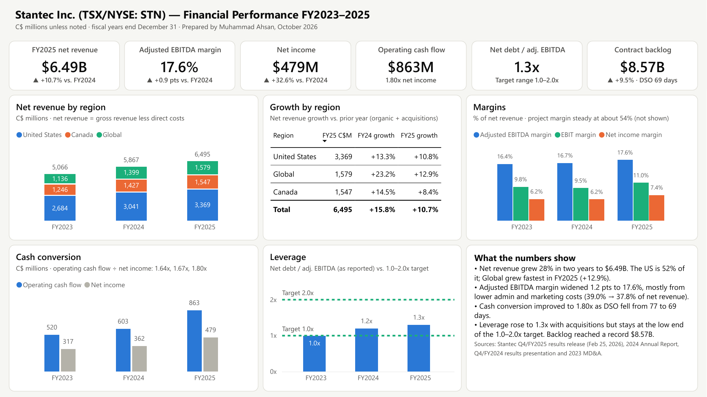
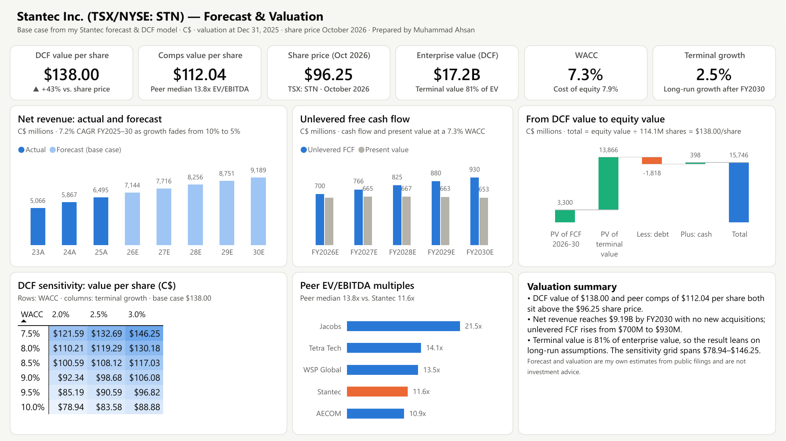

# Stantec Financial Performance Dashboard — Power BI

**A two-page Power BI report on Stantec Inc. (TSX/NYSE: STN): FY2023–2025 results by region, margins, cash conversion and leverage, plus a forecast and valuation page driven by my [Stantec forecast & DCF model](https://github.com/Ahsan1143/stantec-dcf-valuation).**

**Author:** Muhammad Ahsan · [LinkedIn](https://www.linkedin.com/in/ahsan1143) · Level I Candidate in the CFA Program
**Tools:** Power BI (star-schema data model, Power Query, 75 DAX measures), Excel, Python (data pipeline), HTML/JavaScript (web version)



---

## Key findings

**FY2023–2025 performance**
- Net revenue grew from **\$5.07B to \$6.49B** (+15.8% in 2024, +10.7% in 2025), a mix of organic growth and acquisitions.
- The **United States is 52%** of net revenue; **Global** was the fastest-growing region in 2025 (+12.9%).
- **Adjusted EBITDA margin widened from 16.4% to 17.6%**, mostly from lower administrative and marketing costs (39.0% → 37.8% of net revenue in 2025). Project margin held steady at about 54%.
- **Cash conversion improved** to 1.80x: \$863M of operating cash flow against \$479M of net income in 2025, helped by faster collections (DSO 77 → 69 days).
- **Leverage rose with acquisitions** (net debt to adjusted EBITDA 1.0x → 1.3x) but stays at the low end of management's 1.0–2.0x target range. Backlog reached a record **\$8.57B**.

**Forecast and valuation (base case from the DCF model)**
- Net revenue reaches **\$9.19B by FY2030** (7.2% a year), with growth fading from 10% to 5% and no new acquisitions.
- Unlevered free cash flow rises from **\$700M (2026) to \$930M (2030)**.
- DCF value **\$138.00 per share** at a 7.3% WACC and 2.5% terminal growth; peer EV/EBITDA comps imply **\$112.04**. Both sit above the **\$96.25** share price (October 2026).
- Sensitivity across WACC 7.5–10% and terminal growth 2–3% gives **\$79–\$146** per share. Terminal value is 81% of enterprise value, so the result leans heavily on the long-run assumptions.



## What's in this repo

| File | Contents |
|---|---|
| `powerbi/Stantec_Financial_Dashboard.pbix` | **The Power BI report.** Two pages (Performance 2023–2025; Forecast & valuation), star-schema model and 75 DAX measures. Opens with the data already loaded. |
| `reports/Stantec_Financial_Dashboard.pdf` | PDF export of both pages. |
| `powerbi/Stantec_Dashboard_Data.xlsx` | The model's source tables, built from the DCF model by `src/build_dataset.py`. |
| `powerbi/DAX_Measures.dax` | Every measure as plain text, grouped by display folder. Paste it into DAX query view to check the key numbers. |
| `powerbi/Stantec_Theme.json` | Report theme (colours, fonts, card styling). |
| `dashboard/index.html` | Web version of the same dashboard, viewable in any browser or on GitHub Pages. |
| `data/` | `Stantec_DCF_Model.xlsx` (source model; full write-up in [stantec-dcf-valuation](https://github.com/Ahsan1143/stantec-dcf-valuation)) and the extracted JSON dataset. |
| `src/build_dataset.py` | Pulls historicals, forecast, WACC, DCF, comps and sensitivity straight from the DCF workbook, adds company-reported regional and leverage figures, and writes the Power BI workbook and the web dashboard. |

## Data model
```
DimYear (Year, YearLabel, Scenario: Actual/Forecast, ChartLabel, ShortLabel)
   ├──< FactFinancials  one row per year: FY2023-2025 actuals + FY2026-2030 forecast and DCF cash flows
   └──< FactSegment     net revenue by region (Canada, United States, Global)
Valuation · Sensitivity · Comps · EVBridge   (standalone lookup tables from the DCF model)
_Measures                                    (75 measures in 8 display folders)
```
- Margins, ratios and growth rates are **DAX measures, not stored columns**, so they stay correct at any level of the report.
- Year-over-year measures shift `DimYear[Year]` by one with `CALCULATE` / `REMOVEFILTERS`.
- The KPI cards use `[Latest Actual Year]`, so they always show the most recent reported year whatever filters are on the page.
- Fact columns are hidden; the report only exposes the dimension fields and measures.
- The workbook path is a Power Query parameter (`DataFile`), so the report can be pointed at a new copy of the data in one place.

## Sources
- FY2023–2025 income statement, balance sheet and cash flow: my DCF model's Historicals tab, built from Stantec's Q4/FY2025 results release (Feb 25, 2026) and 2024 Annual Report.
- Net revenue by region, adjusted EBITDA, net debt to adjusted EBITDA, DSO and backlog: Stantec Q4/FY2025 results release; Stantec Q4/FY2024 results presentation; Stantec 2023 MD&A (SEC Form 40-F exhibit).
- Forecast, WACC, DCF, comps: my model (base case). Peer multiples from a single source as noted in the model. The forecast and valuation are my own estimates and are not investment advice.

## How to use
- **View:** open `powerbi/Stantec_Financial_Dashboard.pbix` in Power BI Desktop (free, Windows), or open `reports/Stantec_Financial_Dashboard.pdf`.
- **Refresh the data:** in Power BI Desktop, *Transform data → Edit parameters* and set `DataFile` to the full path of `powerbi/Stantec_Dashboard_Data.xlsx` on your machine, then *Refresh*.
- **Change an assumption:** edit the DCF model, then rebuild the data and refresh the report:
  ```bash
  pip install pandas openpyxl
  python src/build_dataset.py data/Stantec_DCF_Model.xlsx
  ```
- **Web version:** open `dashboard/index.html`, or the GitHub Pages copy at [ahsan1143.github.io/stantec-financial-dashboard/dashboard](https://ahsan1143.github.io/stantec-financial-dashboard/dashboard/).
